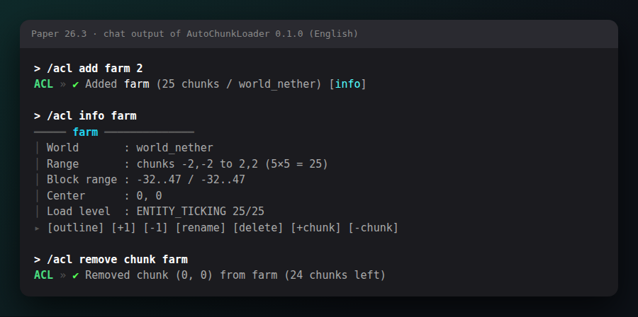

<div align="center">

<p><a href="README.md">English</a> | <b>日本語</b></p>

<h1>AutoChunkLoader</h1>

<h3>短いコマンドでチャンクを読み込んだままにする。近くに誰もいなくても。</h3>

<p>プラグインのチャンクチケットでチャンクを開いたままにする Paper プラグインです。ホッパー、レッドストーン、アイテム仕分け機が、プレイヤーから離れても動き続けます。</p>

<p>
<a href="https://github.com/Lapius7/AutoChunkLoader-plugin/releases/latest"></a>
<a href="https://papermc.io/"></a>
<a href="https://adoptium.net/"></a>


<a href="https://github.com/Lapius7/AutoChunkLoader-plugin/stargazers"></a>
<a href="https://github.com/Lapius7/AutoChunkLoader-plugin/commits/main"></a>
</p>

<p><a href="#quick-start">Quick start</a> · <a href="#コマンド">コマンド</a> · <a href="#設定">設定</a> · <a href="#制限">制限</a></p>

<p></p>

</div>

## 概要

チャンクの上で `/acl add` を実行すると、削除するまでそのチャンクを読み込んだままにします。グループには複数のチャンクを入れられます。自分の周囲の半径、または 2 つのブロック座標で囲んだ範囲を指定できます。どのディメンションでも使えます。

> [!NOTE]
> Paper 26.3 のテストサーバーで、オーバーワールド、ネザー、エンド、カスタムワールドを確認しました。Inspector の `full` モードは 0.1.0 では再確認していません。

## 特長

- 今いるチャンクを短いコマンドで操作: `/acl add`、`/acl remove`、`/acl here`
- 半径、チャンク座標、2 つのブロック座標（`~` 可、y は無視）、`pos1` / `pos2` で追加
- 既存グループにチャンクを 1 つずつ足す・外すことができ、長方形でないグループも作れる
- `list`、`info`、`resize`、`expand`、`rename`。クリックできるボタンとホバー表示つき
- Inspector（`/acl i`）: 登録したチャンクの外周をパーティクルで描き、自分にだけ見える。既定の `edges` は外側の辺だけを描き、`full` は壁全体にリングと支柱を描く
- チケットは参照カウントなので、グループが重なっても安全
- グループは再起動後も残り、すべてのワールドで保存される
- 日本語と英語のメッセージ。どちらの言語ファイルも編集できる

## Quick start

> [!NOTE]
> Paper 26.3 と Java 25 が必要です。ほかの Minecraft バージョンでは、起動時に SEVERE を出して自分を無効化し、何も読み込みません。

1. [Releases](https://github.com/Lapius7/AutoChunkLoader-plugin/releases/latest) から `AutoChunkLoader-0.1.0.jar` をダウンロードして `plugins/` に置き、サーバーを起動します。
2. チャンクの上で `/acl add` を実行します。`/acl here` で確認できます。
3. 削除するときは `/acl remove` です。

## コマンド

`/acl` は `/autochunkloader` と同じです。

<details>
<summary>コマンド一覧</summary>

| コマンド | 内容 |
|---|---|
| `/acl here` | 今いるチャンクの状態（登録の有無、グループ、ロードレベル） |
| `/acl add [名前] [半径]` | 今いるチャンクを登録（名前を省くと自動で付く） |
| `/acl add <名前> <x> <z> [半径] [ワールド]` | チャンク座標で登録 |
| `/acl add <名前> <x1> <y1> <z1> <x2> <y2> <z2> [ワールド]` | 2 つのブロック座標の間にあるチャンクをすべて登録 |
| `/acl pos1`、`/acl pos2`、`/acl add <名前> sel` | 2 点を選んでから登録 |
| `/acl add here <名前>`、`/acl add chunk <名前> [x z]` | 既存グループに今いる（または指定した）チャンクだけを足す |
| `/acl remove [名前]`、`/acl remove chunk <名前> [x z]` | グループを削除（複数チャンクは確認あり）、またはチャンクを 1 つ外す |
| `/acl list [ページ]` | グループ一覧。ワールド名はディメンションごとに色が付く |
| `/acl info [名前]` | グループの詳細 |
| `/acl resize <名前> <+n/-n>` | 四方向に n チャンクずつ拡大・縮小 |
| `/acl expand [名前]` | 今いるチャンクを含むように拡大 |
| `/acl rename <旧名> <新名>` | 名前を変更 |
| `/acl inspector`、`/acl i` | 外周表示の切り替え |
| `/acl spawn <名前\|all> [on\|off]` | プレイヤーが近くにいなくてもグループで自然スポーンさせる（既定は off。権限 `autochunkloader.spawn`）。`all on\|off` で操作できる全グループを一括切替、`all` だけで全グループの状態を一覧表示 |
| `/acl randomtick <名前\|all> [on\|off]` | グループのランダムティック（作物の成長・草の伸び・氷解けなど）の切替（既定は on。権限 `autochunkloader.randomtick`）。`all` の使い方は `spawn all` と同じ |
| `/acl reload` | 設定と言語ファイルを再読み込み |

</details>

### 権限

| 権限 | できること | 既定 |
|---|---|---|
| `autochunkloader.use` | list、info、here、inspector、help | 全員 |
| `autochunkloader.manage` | 自分のグループの add、remove、resize、expand、rename | op |
| `autochunkloader.admin` | 他人のグループの操作、reload、上限の無視 | op |

## 設定

`plugins/AutoChunkLoader/config.yml`:

| キー | 既定 | 内容 |
|---|---|---|
| `language` | `ja` | `ja` または `en`。メッセージは `lang/<code>.yml` で変更できる |
| `limits.max-radius` | `4` | 中心＋半径で作るグループの最大半径。大きさは (2r+1)² |
| `limits.max-chunks-per-group` | `100` | 1 グループのチャンク数 |
| `limits.max-chunks-total` | `200` | サーバー全体で保持するチャンク数 |
| `limits.max-groups-per-player` | `5` | 1 人あたりのグループ数 |
| `inspector.mode` | `edges` | `edges` または `full` |
| `inspector.*` | | 半径、高さ、間隔、粒の間隔、線の間隔、距離による間引き、粒子数の上限、色とサイズ |
| `list.page-size` | `8` | `/acl list` の 1 ページあたりの件数 |

## 制限

> [!IMPORTANT]
> **プレイヤーがいないときにサーバーを止める設定は使えません。** チケットが保つのは、サーバー自体が動いている間のチャンクの読み込みと tick です。`server.properties` の `pause-when-empty-seconds` に正の値を入れる（Paper 26.3 の既定は `-1` で無効）と、誰もいない状態がその秒数続いた時点でサーバー全体が止まり、登録したチャンクも一緒に止まります。ホッパー、レッドストーン、湧きがすべて止まります。無人でも装置を動かすなら `-1` のままにしてください。Paper の `disable-world-ticking-when-empty` はワールド単位の似た設定です。こちらも `false` にしてください。

> [!NOTE]
> Paper 26.3 で、どのプレイヤーからも遠いチャンク（ロードレベル `ENTITY_TICKING`）を、オーバーワールド・ネザー・エンド・カスタムワールドで試しました。誰もいないワールドも含みます。
> - レッドストーンは動いた。観察者クロック、ピストン、ホッパーが 10 分以上動き続けた。
> - 遠方でも作物が育った。小麦、ネザーウォート、コーラスフラワー（ランダムティック）。
> - モブは `/acl spawn <名前> on` のときだけ湧きます（下記）。

> **自然スポーン（`/acl spawn <名前> on`）。** スポーンを on にしたグループでは、128 ブロック以内にプレイヤーがいないチャンクでも、バニラと同じ自然スポーンが起こります。湧く位置、バイオームごとのモブ、明るさと足場の条件、湧く間隔、群れの数は同じです。外すのは「プレイヤーが 128 ブロック以内にいる」条件だけで、対象もこれらのチャンクだけです。どのディメンションでも動き、そのワールドに誰もいなくても湧きます。このチャンクのモブは、プレイヤーが離れていても消えません。プレイヤーが近いチャンクは、これまでどおりバニラが処理します。
> - モブの上限: ワールド全体で 1 つで、そこにいるすべてのモブとバニラと同じ数え方で共有します。遠方のチャンクにも、近くのプレイヤーと同じ上限がかかります（Paper 既定の `per-player-mob-spawns` では上限そのもの。例: モンスター 70 体）。そのため、遠方のトラップが同じトラップをプレイヤーの隣に置いたときより速く増えることはありません。
> - Paper 26.3 での確認: 同じ暗室トラップを近くと遠くに置いた。どちらも 10 秒で約 25 体まで増え、その後 3 分間 26〜33 体で安定した。上限を 1000 に上げると、60 秒で近くが約 500 体、遠くが約 360 体になった。
>
> **ランダムティック（`/acl randomtick <名前> on|off`。既定は on）。** 作物の成長、草の伸び、氷解け、葉の枯れ、火の延焼は、ランダムティックで進みます。`off` にすると、そのグループのチャンクだけでこれらが止まります。チャンクは読み込まれたままで、エンティティ・ホッパー・レッドストーン・予約ティックは普段どおり動きます。ほかのチャンクは、登録の有無やプレイヤーの近さにかかわらず影響を受けません。プレイヤーが近くにいるチャンクでも、グループの設定が優先され、止まります。
> - 重なるグループ: チャンクのランダムティックが動くのは、そのチャンクを含むすべてのグループが on のときだけです。1 つでも `off` があれば止まります。
> - 影響しないもの: ブロックのランダムティックではない天候の効果（雨での積雪・氷結、落雷）。
> - 設定は `data.yml`（`randomtick: false`）に保存され、再起動後も残ります。`/acl info` では `[ON] [OFF]` のボタンで状態を確認・切替できます。
> - 仕組み: サーバーが 1 ティックを処理する間だけ、対象のセクションが「ランダムティックするブロックなし」と答えるようにし、ティックの終わりに本来の値へ戻します。その間に起きたブロックの変更は保たれます。

<details>
<summary>ソースからビルドする</summary>

Java 25 が必要です。jar は `build/libs/` に出力されます。

```sh
./gradlew build
```

</details>
