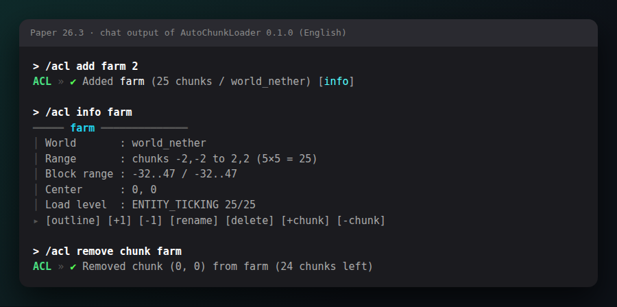

<b>English</b> | <a href="README.ja.md">日本語</a>

<h1>AutoChunkLoader</h1>

<h3>Keep chunks loaded with one short command, even when nobody is nearby.</h3>

A Paper plugin that holds chunks open with plugin chunk tickets, so hoppers, redstone and item sorters keep running far from players.

<a href="#quick-start">Quick start</a> · <a href="#commands">Commands</a> · <a href="#configuration">Configuration</a> · <a href="#limits">Limits</a>

## Overview

Stand in a chunk and run `/acl add`. The plugin keeps that chunk loaded until you remove it. A group can also cover many chunks: a radius around you, or the box between two block positions. Groups work in every dimension.

> [!NOTE]
> Checked on a Paper 26.3 test server in the Overworld, the Nether, the End and a custom world. The `full` Inspector mode was not re-checked for 0.2.0.

## Features

- Short commands for the chunk you stand in: `/acl add`, `/acl remove`, `/acl here`
- Add by radius, by chunk coordinates, or by two block positions (`~` allowed, y ignored), or with `pos1` / `pos2`
- Add or remove a single chunk of an existing group, so groups need not be rectangles
- `list`, `info`, `resize`, `expand` and `rename`, with clickable buttons and hover text
- Inspector (`/acl i`): outlines the kept chunks with particles that only you can see. The default `edges` mode draws only the outer edges; `full` draws rings and posts over the whole wall
- Tickets are reference counted, so overlapping groups are safe
- Groups survive restarts, in every world
- Japanese and English messages; both language files are editable

## Quick start

> [!NOTE]
> Requires Paper 26.3 and Java 25. On any other Minecraft version the plugin logs a SEVERE message at startup, disables itself and loads nothing.

1. Download `AutoChunkLoader-0.2.0.jar` from [Releases](https://github.com/Lapius7/AutoChunkLoader-plugin/releases/latest) and put it in `plugins/`, then start the server.
2. Stand in a chunk and run `/acl add`. Check it with `/acl here`.
3. Remove it with `/acl remove`.

## Commands

`/acl` is the same as `/autochunkloader`.

All commands

| Command | What it does |
|---|---|
| `/acl here` | Status of the current chunk: registered or not, group, load level |
| `/acl add [name] [radius]` | Register the current chunk (auto-named when no name is given) |
| `/acl add <name> <x> <z> [radius] [world]` | Register by chunk coordinates |
| `/acl add <name> <x1> <y1> <z1> <x2> <y2> <z2> [world]` | Register every chunk between two block positions |
| `/acl pos1`, `/acl pos2`, `/acl add <name> sel` | Select two points, then register |
| `/acl add here <name>`, `/acl add chunk <name> [x z]` | Add only the current (or given) chunk to an existing group |
| `/acl remove [name]`, `/acl remove chunk <name> [x z]` | Delete a group (multi-chunk groups ask for confirmation), or remove one chunk from it |
| `/acl list [page]` | List groups; world names are coloured by dimension |
| `/acl info [name]` | Details of a group |
| `/acl resize <name> <+n/-n>` | Grow or shrink by n chunks on every side |
| `/acl expand [name]` | Grow to include the current chunk |
| `/acl rename <old> <new>` | Rename a group |
| `/acl inspector`, `/acl i` | Toggle the outline (your choice is saved per player and restored after reconnect or restart) |
| `/acl undo`, `/acl redo` | Undo / redo your own last changes (create, delete, rename, resize, chunk add/remove, spawn and random-tick switches). Repeatable up to `undo.limit` (default 20); history is per player and lost on restart or when you leave. Refused if the group was changed by something else since. Every change also shows a clickable [undo] button |
| `/acl inspectorall [on\|off]`, `/acl iall` | Force the outline on for every online player, including later joiners; no argument toggles. Saved across restarts. Players far from any kept chunk get nothing drawn |
| `/acl spawn <name\|all> [on\|off]` | Natural mob spawning in a group, even with no player nearby (off by default; needs `autochunkloader.spawn`). `all` with `on`/`off` switches every group you may manage; `all` alone lists every group's state |
| `/acl randomtick <name\|all> [on\|off]` | Random ticks (crop growth, grass spread, ice melt...) in a group (on by default; needs `autochunkloader.randomtick`). `all` works like `spawn all` |
| `/acl reload` | Reload config and language files |

### Permissions

| Permission | Allows | Default |
|---|---|---|
| `autochunkloader.use` | list, info, here, inspector, help | everyone |
| `autochunkloader.manage` | add, remove, resize, expand, rename your own groups | op |
| `autochunkloader.spawn` | `/acl spawn` on your own groups | op |
| `autochunkloader.randomtick` | `/acl randomtick` on your own groups | op |
| `autochunkloader.inspectorall` | `/acl inspectorall` | op |
| `autochunkloader.admin` | any group, reload, ignore limits | op |

## Configuration

`plugins/AutoChunkLoader/config.yml`:

| Key | Default | Meaning |
|---|---|---|
| `language` | `ja` | `ja` or `en`. Edit `lang/<code>.yml` to change messages |
| `limits.max-radius` | `4` | Largest radius for center + radius groups; size is (2r+1)² |
| `limits.max-chunks-per-group` | `100` | Chunks in one group |
| `limits.max-chunks-total` | `200` | Chunks kept on the whole server |
| `limits.max-groups-per-player` | `5` | Groups per player |
| `inspector.mode` | `edges` | `edges` or `full` |
| `undo.limit` | `20` | steps `/acl undo` keeps per player (`0` = off) |
| `inspector.*` | | radius, height, interval, step, spacing, falloff, particle cap, `all-max-particles` (cap for players shown only by `inspectorall`), colours and sizes |
| `list.page-size` | `8` | Groups per page of `/acl list` |

## Limits

> [!IMPORTANT]
> **The server must not pause when empty.** A ticket keeps chunks loaded and ticking only while the server itself ticks. With `pause-when-empty-seconds` set to a positive value in `server.properties` (Paper 26.3 default is `-1`, off), the whole server stops once nobody has been online for that many seconds, and every kept chunk stops with it: hoppers, redstone and spawning. Keep it at `-1` if machines must run while the server is empty. Paper's `disable-world-ticking-when-empty` is a related per-world switch; leave it `false` too.

> [!NOTE]
> Tested on Paper 26.3 with chunks far from every player (load level `ENTITY_TICKING`), in the Overworld, Nether, End and a custom world, including worlds with nobody in them:
> - Redstone ran: observer clocks, pistons and hoppers kept working for over 10 minutes.
> - Crops grew far away: wheat, nether wart and chorus flowers (random ticks).
> - Mobs spawn only with `/acl spawn <name> on` (below).

> **Natural spawning (`/acl spawn <name> on`).** For a group with spawning on, chunks that have no player within 128 blocks get vanilla natural spawning: the same spawn positions, biome mobs, light and floor rules, spawn interval and group sizes. Only the "a player must be within 128 blocks" rule is dropped, and only for these chunks. It works in every dimension, even when nobody is in that world. Mobs there do not despawn while the player is away. Chunks near a player stay vanilla.
> - Mob cap: one cap for the whole world, shared with every mob in it and counted as vanilla counts. A far chunk gets the same cap a nearby player gets (with Paper's default `per-player-mob-spawns`, the limit itself, for example 70 monsters). A far trap therefore fills no faster than the same trap beside a player.
> - Tested on Paper 26.3 with identical dark-room traps near and far: both reached about 25 monsters within 10 seconds and then held 26 to 33 for 3 minutes. With the cap raised to 1000, near and far reached about 500 and 360 in 60 seconds.
>
> **Random ticks (`/acl randomtick <name> on|off`, default on).** Random ticks are what grow crops, spread grass, melt ice, decay leaves and spread fire. With `off`, they stop in every chunk of the group and nowhere else. The chunk stays loaded, entities, hoppers, redstone and scheduled ticks run as before, and other chunks (registered or not, near a player or not) are not touched. Chunks near a player are switched off too, since the group is what counts.
> - Overlapping groups: a chunk has random ticks only while every group that contains it has them on. One group with `off` is enough to stop them.
> - Not affected: weather effects that are not random ticks of a block (snow and ice forming in rain, lightning).
> - The setting is saved in `data.yml` (`randomtick: false`) and kept across restarts. `/acl info` shows the state with `[ON] [OFF]` buttons.
> - How: while the server ticks, the affected sections report no random-ticking blocks, and the real values are put back at the end of the tick. Block changes made in between are kept.

## License

[MIT](LICENSE)
